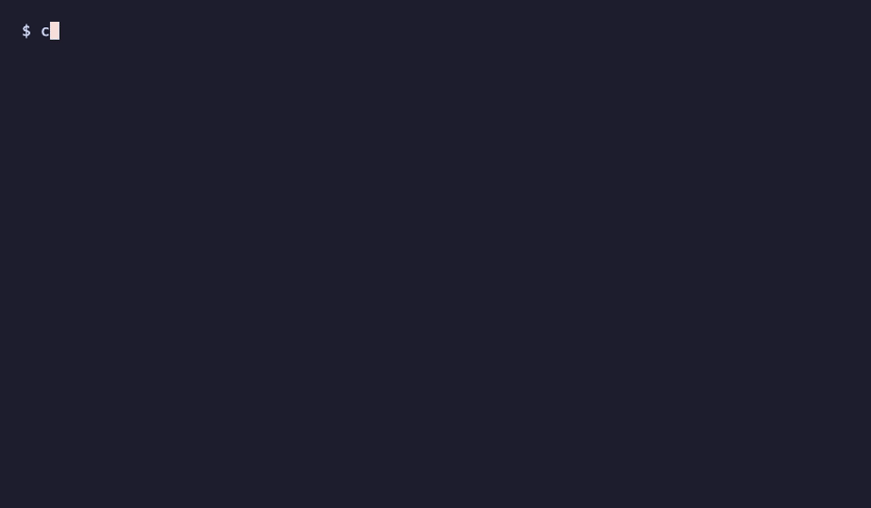

# certrally

[](https://github.com/misiektoja/certrally/releases)
[](https://github.com/misiektoja/certrally)
[](https://github.com/misiektoja/certrally/commits/main)
[](https://github.com/misiektoja/certrally)
[](LICENSE)
[](https://github.com/misiektoja/certrally/actions/workflows/test.yml)
[](https://github.com/misiektoja/certrally/actions/workflows/supply-chain.yml)
[](https://scorecard.dev/viewer/?uri=github.com/misiektoja/certrally)

certrally is a command line client for certificate enrollment with the Certificate Management Protocol (CMP), Enrollment over Secure Transport (EST) and the Simple Certificate Enrolment Protocol (SCEP). The documentation is at [misiektoja.github.io/certrally](https://misiektoja.github.io/certrally/).



<!-- --8<-- [start:features] -->
**CMP** (RFC 9810, which replaces RFC 4210, with the RFC 9483 profile)

* `ir`, `cr`, `kur`, `p10cr` and `rr` with a shared secret or a certificate
* Keys that the CA generates (central key generation)
* Requests forwarded by a registration authority in nested messages
* CA certificates, root CA updates, request templates and CRLs from the CA
* `ping` to check a server and `mock` to run a test CA on your machine
* Deliberately wrong messages with `enroll --fault` to test how a CA copes
* A step-by-step `enroll` that prints the matching command for scripts

**EST** (RFC 7030)

* Enrollment, renewal, server key generation, CA certificates and CSR attributes
* Authentication with a password, a bearer token, a TLS client certificate or TLS-SRP
* `est mock` to run a test EST CA on your machine

**SCEP** (RFC 8894)

* Enrollment, renewal and polling of pending requests, also in a later run
* CA certificates, the CA chain, the next CA certificate, certificates and CRLs from the CA
* Digest, cipher and HTTP method chosen from the server capabilities, with old algorithms on request
* `scep mock` to run a test SCEP CA on your machine

**All protocols**

* A live diagram of every message and plain explanations of failures
* RSA, ECDSA, Ed25519, ML-DSA, composite ML-DSA and ML-KEM keys, also offline with `keygen`. SCEP takes RSA and ECDSA keys
* No trust setup: certrally trusts the CA it talks to or the one in `--ca-cert`
* Warnings about responses that break the RFCs and a strict profile that rejects them
* JSON output, capture files and exit statuses for scripts
* `inspect` and `lint` to decode recorded messages and check them
<!-- --8<-- [end:features] -->

Tested with EJBCA, Nokia NCM, Insta Certifier and the `openssl cmp` mock server over CMP, with Cisco libest over EST and with EJBCA, Nokia NCM, OpenXPKI and micromdm/scep over SCEP. See [Tested servers](https://misiektoja.github.io/certrally/interop/).

## Install

<!-- --8<-- [start:install] -->
Each [release](https://github.com/misiektoja/certrally/releases) has archives for Linux, macOS and Windows on amd64 and arm64. A binary downloaded with a browser on macOS needs `xattr -d com.apple.quarantine certrally` before its first run, because it is not notarized.

With Homebrew on macOS or Linux, which also installs shell completions:

```bash
brew install misiektoja/tap/certrally
```

As a container image for linux/amd64 and linux/arm64:

```bash
docker run --rm ghcr.io/misiektoja/certrally --help
```

The image runs as an unprivileged user. To save files to the current directory, run it as your user and mount the directory:

```bash
docker run --rm --user "$(id -u):$(id -g)" -v "$PWD:/work" -w /work -e CERTRALLY_SECRET \
  ghcr.io/misiektoja/certrally enroll --server https://ca.example.com/.well-known/cmp \
  --ref device-42 --cert-out device.pem --key-out device.key
```

From source with Go 1.27.3 or newer:

```bash
go install github.com/misiektoja/certrally/cmd/certrally@latest
```
<!-- --8<-- [end:install] -->

Releases are signed with cosign and carry GitHub build provenance and SBOMs. [Verify a download](https://misiektoja.github.io/certrally/verify/) shows how to check one.

## Quick start

`certrally mock` runs a CMP test CA on your machine and prints an `enroll` command that works against it:

```bash
certrally mock --ca-out ca.pem
```

Run the printed command in another terminal. Against a real CA, a device that has a shared secret from the CA requests its first certificate like this:

```bash
certrally enroll --server https://ca.example.com/.well-known/cmp \
  --ref device-42 --secret-file secret.txt \
  --subject CN=device-42,O=Example --san device-42.example.com \
  --cert-out device.pem --key-out device.key
```

certrally draws each message as it is sent and received, then describes the certificate:

```text
  certrally                                           ca.example.com
  │                                                                │
  │ ir  PBMAC1  506 B                                              │
  │ ─────────────────────────────────────────────────────────────▶ │
  │                            ip  accepted  PBMAC1  1.5 KiB  9 ms │
  │ ◀───────────────────────────────────────────────────────────── │
  │ certConf  PBMAC1  291 B                                        │
  │ ─────────────────────────────────────────────────────────────▶ │
  │                                   pkiconf  PBMAC1  637 B  2 ms │
  │ ◀───────────────────────────────────────────────────────────── │

✓ Certificate issued
  Subject    CN=device-42,O=Example
  Alt names  device-42.example.com
  Issuer     CN=Example CA
  Serial     94:01:1D:E4:EA:C9:F1:25:59:06:0B:13:86:06:94:7D
  Valid      2026-10-13 00:20 UTC to 2027-10-13 00:21 UTC
  Key        ECDSA P-256
  Status     accepted
  Saved      device.key, device.pem
```

[Getting started](https://misiektoja.github.io/certrally/getting-started/) continues with key updates, step-by-step enrollment, revocation and trust. [Enroll over EST](https://misiektoja.github.io/certrally/est/) and [Enroll over SCEP](https://misiektoja.github.io/certrally/scep/) cover the other protocols.

## Documentation

The full documentation is at [misiektoja.github.io/certrally](https://misiektoja.github.io/certrally/):

* [Install](https://misiektoja.github.io/certrally/install/)
* [Getting started](https://misiektoja.github.io/certrally/getting-started/): commands, a first CMP enrollment, key updates, revocation and trust
* [CMP details](https://misiektoja.github.io/certrally/cmp/): request options, collecting a certificate later, ML-KEM keys, keys that the CA generates, registration authorities, trust, revocation by serial number, CA information and `ping`
* [Enroll over EST](https://misiektoja.github.io/certrally/est/): commands, sign-in options, bootstrap, proxies, waiting, channel binding and the `est mock` test CA
* [Enroll over SCEP](https://misiektoja.github.io/certrally/scep/): commands, trust, the challenge password, algorithms, pending requests, renewal, queries and the `scep mock` test CA
* [Keys and output files](https://misiektoja.github.io/certrally/keys/): key types, encrypted keys, `keygen` and DER output
* [Scripts and exit status](https://misiektoja.github.io/certrally/scripts/): `--json`, capture files and exit statuses
* [JSON output and capture files](https://misiektoja.github.io/certrally/json/)
* [Response profiles](https://misiektoja.github.io/certrally/profiles/): the rules certrally checks
* [Inspect and lint recorded messages](https://misiektoja.github.io/certrally/inspect/)
* [Output and colour](https://misiektoja.github.io/certrally/output/)
* [The CMP test CA](https://misiektoja.github.io/certrally/mock/): `certrally mock` and its fault flags
* [Testing a CA with faulty messages](https://misiektoja.github.io/certrally/faults/): `enroll --fault` and `poll --fault`
* [Tested servers](https://misiektoja.github.io/certrally/interop/)
* [Verify a download](https://misiektoja.github.io/certrally/verify/)

The pages are also readable on GitHub in [docs/](docs/).

## Contributing

See [CONTRIBUTING.md](CONTRIBUTING.md). Report security issues as described in [SECURITY.md](SECURITY.md).

## License

certrally is licensed under the [Apache License 2.0](LICENSE).
